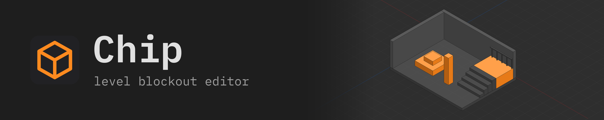
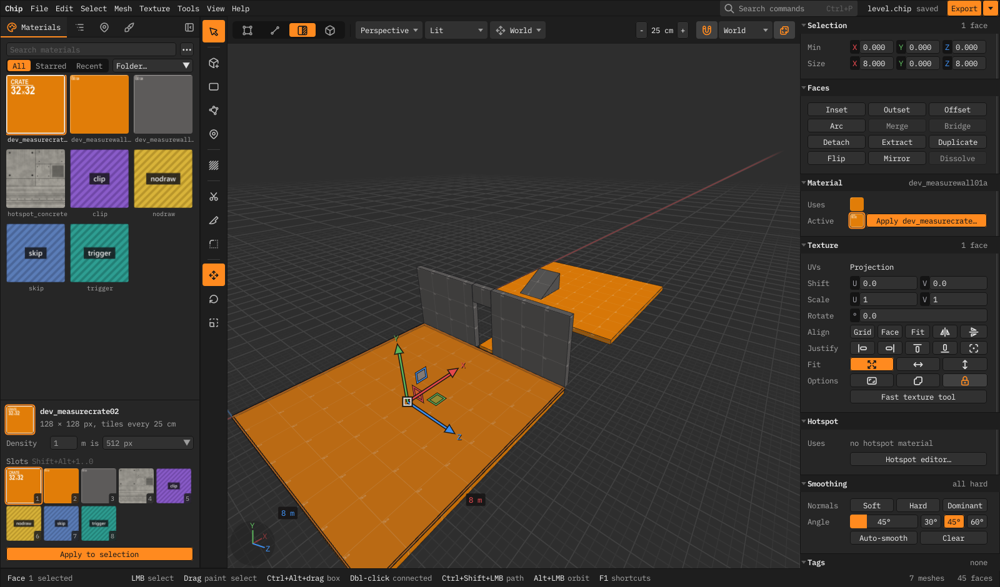
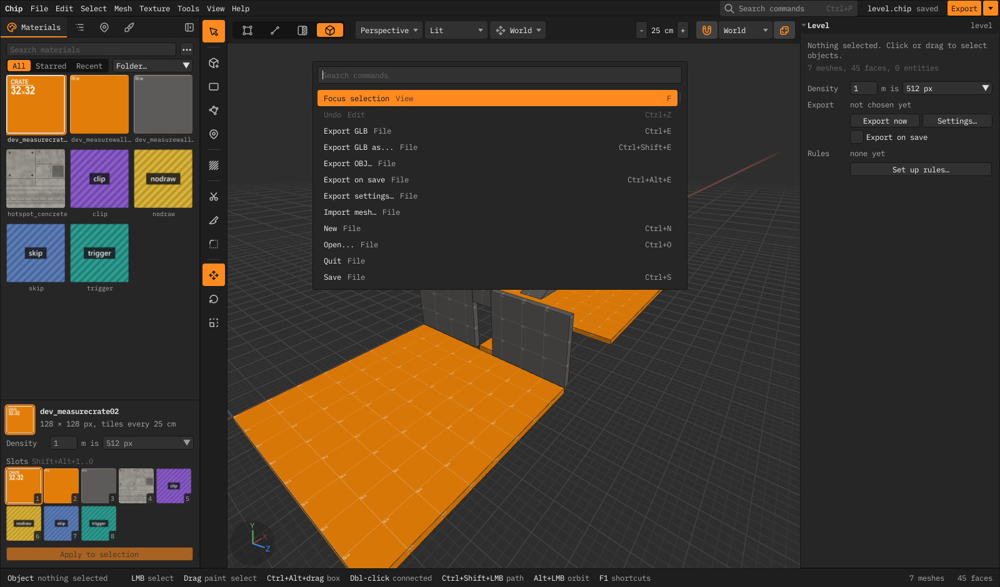
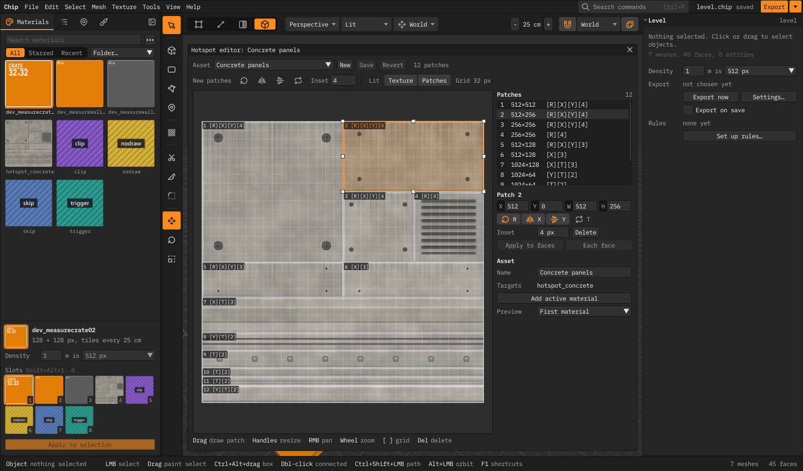
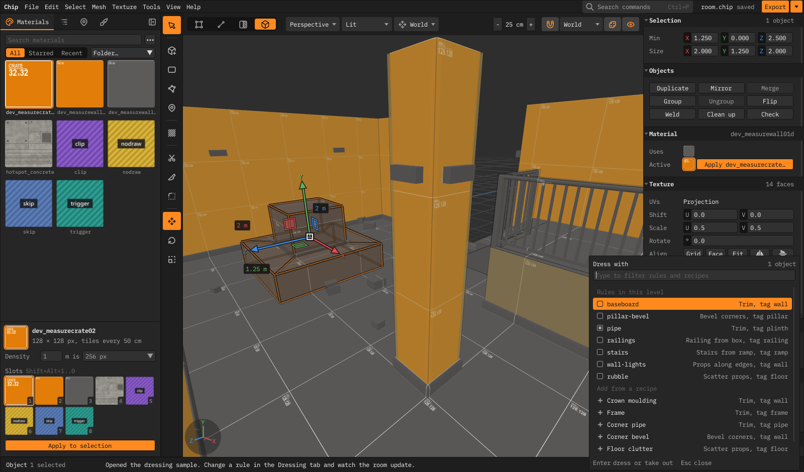
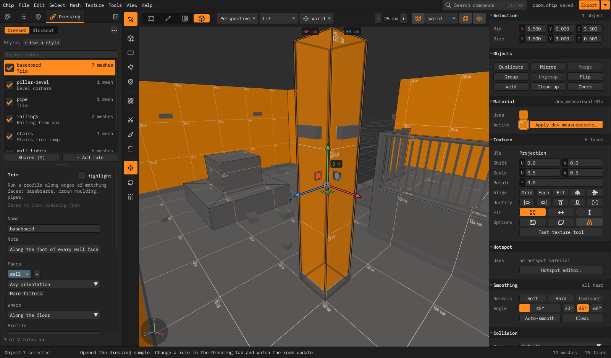

<p align="center"></p>

Chip is a standalone editor for blocking out game levels, in the spirit of Scythe and Source 2 Hammer. You build rooms
out of polygon meshes, texture them on a metre grid, place entities, and export a `.glb` that Godot (or anything else
that reads glTF) imports as a level with its collision. Rules called **dressing** turn the blockout into finished
geometry, such as baseboards along the walls, railings and stairs, and they update when you change the blockout.


- [Getting Chip](#getting-chip)
- [Your first room](#your-first-room)
- [The window](#the-window)
- [Building geometry](#building-geometry)
- [Materials and texturing](#materials-and-texturing)
- [Dressing](#dressing)
- [Reference models and entities](#reference-models-and-entities)
- [Exporting to your engine](#exporting-to-your-engine)
- [Shortcuts](#shortcuts)
- [Settings and files](#settings-and-files)
- [Not there yet](#not-there-yet)

## Getting Chip

Chip runs on Windows and needs OpenGL 3.3. There are no prebuilt downloads yet, so you build it once with the
[.NET 10 SDK](https://dotnet.microsoft.com/download):

```
powershell -File scripts/publish.ps1
```

This writes `artifacts/publish/win-x64/Chip.exe` with an `assets` folder beside it. Keep the two together; you can move
the folder anywhere. To run Chip straight from the source tree instead, use `dotnet run --project src/Chip.Editor`.

## Your first room

1. Press **Shift+B** (block). Drag out the floor on the grid, release, move the mouse to set the height, and click.
2. Draw a wall the same way. `[` and `]` change the grid size, from 3 cm to 16 m.
3. Press **3** for face mode, click a wall's face and **Shift+drag** the move gizmo to extrude it.
4. Press **T** for the Materials tab, pick a texture and click **Apply to selection**, or press **Shift+T**.
5. Press **Ctrl+S** to save the level as a `.chip` file and **Ctrl+E** to export it. The first export asks where the
   `.glb` goes, and later exports overwrite that file.

Everything is in metres. Press **F1** for the full shortcut sheet, or **Ctrl+P** to find any command by name.

## The window



From left to right:

- **The dock** holds what you pick from, as tabs: **Materials** (`T`: search, folders, starred and recent, the active
  material with its own texel density, the `Shift+Alt` slots, Apply), **Scene** (`Ctrl+Shift+O`: the outliner,
  unhide/unlock all, selection sets), **Place** (entity classes and reference models: click one, then click in the
  viewport) and **Dressing** (`Ctrl+Shift+D`: the rules). Click the showing tab's icon, or press its key again, to
  collapse the dock to an icon rail; `Ctrl+\` toggles it.
- **The tool strip** sits beside the viewport: select, create (block, rectangle, polygon, entity), fast texture, cut
  (clip, knife, bevel), then move/rotate/scale.
- **The viewport header** holds how you look and select (vertex/edge/face/object, projection, shading, grid, snap,
  backfaces). It drops its labels when the viewport is narrow.
- **The inspector** is about the selection only: its bounds, buttons for the mesh operations of the selection mode
  (inset, offset, bridge, weld, merge, group…), then its surface (material, texture, hotspot), smoothing and collision,
  and last its tags and dressing. Click a section's title to fold it. With nothing selected it shows the **Level**:
  texel density, where it exports, export on save, and its dressing rules.
- **The menu bar** ends with **Export** (`Ctrl+E`; the arrow beside it has Export as, OBJ, Export on save and the export
  settings).
- **The status bar** says what just happened and which keys the current tool uses.



## Building geometry

**Creating.** The block tool (`Shift+B`) makes boxes, cylinders, wedges, stairs, arches, spheres, tori and spiral stairs;
pick the shape in the tool's options. The polygon tool (`Shift+P`) takes an outline you click point by point, then a
height, and makes a prism. The rectangle tool (`Shift+R`) makes a single one-sided quad whose open edges you extrude
from. Hold Shift on the first click to stand the drawing plane up toward the camera. Hold Ctrl to bypass snapping while drawing or setting height.

**Selecting.** `1`–`4` switch between vertex, edge, face and object mode. Click to select, Shift to add, Ctrl to toggle,
or drag to paint a selection. `Ctrl+Alt+drag` box-selects. Double-click selects everything connected, `L` and `X` select
edge loops and rings, `Alt+=` and `Alt+-` grow and shrink, and `Ctrl+Shift+click` selects a path. You can save and
restore named selection sets from the Select menu.

**Editing.** Move (`W`), rotate (`E`) and scale (`R`) with the gizmo, or type exact numbers while you drag: `1.5`,
`150cm`, `90°`, `150%`. `Shift+drag` extrudes faces or edges and `Ctrl+Shift+drag` pushes and pulls faces. The Mesh menu
and the inspector have the rest:

| | |
|---|---|
| Faces | inset `I`, outset `O`, offset along normals `Shift+O` (for trims and baseboards), arc extrude `Shift+A`, bridge `Shift+C`, merge faces `Backspace`, detach `N`, extract `Alt+N` |
| Edges and vertices | bevel `B`, connect `V`, bridge `Shift+C` (any number of open chains at once), fill holes `Alt+F` (pick one rim edge), collapse, weld `Ctrl+Shift+Alt+M`, dissolve `Ctrl+Backspace` |
| Cutting | knife `C`, clip with a plane `Shift+X` (`Tab` keeps the front, the back or both) |
| Meshes | merge `M`, mirror `Shift+Z`, flip `Shift+N`, snap vertices to the grid `Ctrl+Shift+Alt+V`, clean up, check |
| Smoothing | soft `J`, hard `Ctrl+J`, dominant `K`, auto-smooth by angle |

**Organising.** Group with `Ctrl+G`, lock with `Ctrl+L`, hide with `H`. The Scene tab lists every folder, group, mesh
and entity; a group selects as one, a folder only sorts things (its button, or Edit > New folder, makes one). `F2`
renames, dragging moves things into folders and groups, and right-click has the rest. `Ctrl+T` tags faces (or whole
meshes in object mode); dressing rules find their targets by tag.

**Origins.** A mesh or group can have its own origin: Mesh > Origin to bottom centre (or centre, or the pivot, which
in vertex, edge or face mode is the selected components), or the Origin section of the inspector. The selected object then
turns and scales about its origin, the Local gizmo follows its axes, and export places the mesh's node there instead of
at the world origin. Clear origin goes back to pivoting on the bounds centre.

**Linked copies.** Build a prop once and place it many times: select its meshes and press `Ctrl+Alt+D` (Edit >
Duplicate linked). Each copy can be moved and turned on its own, but an edit to any copy, with any tool, changes all of
them as you make it. `Shift+D` on a copy makes another linked copy; Edit > Make unique breaks one off. Copies have a link
icon in the Scene tab, and export writes each part's mesh once for all the copies.

**Prefabs.** To use a prop in other levels, select it and choose Edit > Save as prefab…. It becomes a
`name.prefab.chip` file in your project (the folder with `chip.project.json` or `project.godot`, in `prefabs/` unless
the project's `"prefabs": { "default": "props" }` says otherwise). The Place tab lists every prefab in the project:
click one, then click in the viewport. Editing any copy in any level saves the prefab file, and other levels pick the
change up when they open (or straight away, if they're open). Edit > Open prefab edits the file on its own: your level
waits, unsaved changes and all, and the Back button over the viewport returns to it with its copies updated. Moving or
renaming a prefab file is fine: levels find it again by the id inside it.

**Picking among overlapping things.** Click the same spot again to select the next object under the cursor (the entity
behind a wall, the wall inside a trigger volume), or `Ctrl`+right-click (`Alt+S`) for a list of all of them. `5` makes
object mode pick entities only, so walls and floors stay out of the way; the dropdown beside the modes switches back.

**Looking.** Fly with the right mouse button and WASD/QE, orbit with Alt+left drag, focus with `F`. `Alt+1`–`Alt+4`
switch between perspective, top, front and side, and the View menu splits the viewport into two or four views.
`Ctrl+Shift+1`–`9` store camera bookmarks and `Ctrl+1`–`9` recall them. `Alt+Z` cycles lit, unlit, wireframe and a UV
checker.

## Materials and texturing

Materials are image files (PNG, JPEG or TGA) in folders. Chip ships a few measuring textures in `assets/textures`; add
your own folders with Texture > Add texture folder, or list them in the `CHIP_TEXTURE_DIRS` environment variable.
`Shift+Alt+1`…`0` apply the first ten slots in the Materials tab, and `Shift`+right-click lifts the material off a face.

Texel density is set per level, Scythe style, under Level in the inspector (with nothing selected). "1 m is 256 px" by
default, so a 128 px texture tiles every 50 cm. A texture can have its own density, set in the Materials tab under the
active material.

Textures with an alpha channel draw see-through. Chip reads the alpha: crisp holes become a **cutout** (fences, foliage,
grates; holes under 50 %) and soft alpha becomes **blend** (glass, water). Change it under Alpha in the Materials tab.
The glTF export writes the same `alphaMode`, so the engine shows what the viewport shows.

Faces draw from the front only. Tick **Double-sided** under the active material for single-plane fences and foliage
cards. They then draw and pick from behind, and export with glTF `doubleSided`. It only changes rendering: a one-plane
collider may still block from the front only.

The Texture menu and the inspector align, fit, justify, shift, scale and rotate the texture on the selected faces, and
unwrap them five ways. `Alt`+right-click continues the selected face's texture onto the face you click. The **fast texture tool**
(`Shift+Q`) floats over the viewport and puts the common texture operations on single keys.

Four tool materials change how faces export instead of how they look: **nodraw** is never rendered but still collides,
**clip** is collision only, **trigger** exports as a trigger volume, and **skip** is left out of the export. A game can
add its own surfaces, such as a monster clip, water, or a screen it swaps for a video, in its `chip.project.json`
([docs/engines.md](docs/engines.md)). Tool surfaces draw see-through, striped in world space; View > Translucent tool
surfaces makes them solid.

**Hotspots.** A hotspot texture is a trim sheet divided into patches. `Shift+H` gives each flat region of the selection
the patch that fits it best, and `Shift+F` does the same for each face on its own. The hotspot editor (`Ctrl+Shift+H`,
or the Materials tab's ⋯ menu) is where you draw and edit the patches. Chip ships one sample, a concrete panel sheet.



## Dressing

Dressing rules turn the blockout into the level you ship: baseboards and trims along walls, pipes in corners, bevelled
corners, boxes that become railings, ramps that become stairs, lights along walls, rubble on floors. You keep editing the
plain blockout, and the dressing follows.

| Dressed | Blockout (`` ` ``) |
|---|---|
|  |  |

To try it, open the Dressing tab's ⋯ menu and choose **Open dressing sample**.

To dress your own level, select some walls and press **Ctrl+Shift+T** (Dress with). Pick a recipe (baseboard, crown
moulding, frame, corner pipe, corner bevel, wall lights, floor clutter, railing or stairs) and Chip adds the rule, tags
the selection and applies it in one undo step.



The Dressing tab (`Ctrl+Shift+D`) edits the rules in centimetres and plain words. Hovering a rule highlights what it
dresses. Rules can live in shared styles, so several levels use the same baseboard.



- `` ` `` switches between the dressed level and the bare blockout. Export always ships the dressed level.
- To change a rule for one mesh only, use the Dressing section of the inspector. To edit the result by hand, use
  Edit > Bake dressing.
- If a face isn't dressed, select it: the inspector says why each rule skips it.
- The rules are saved as JSON beside the level (`level.dressing.json`). Chip reloads the file when it changes on disk, so
  you can also edit it in a text editor or have a script write it.

[docs/dressing.md](docs/dressing.md) covers every rule kind, the file format and the known limits.

## Reference models and entities

**Reference models** (the Place tab) show a `.glb` in the level for scale, such as your door or the built-in 1.78 m
figure. Click a wall and a door sits inside it. Turn on "Export as marker" to export an empty node where the real asset
goes; otherwise references stay in the editor. Chip reloads a reference when its file changes.

**Entities** are things placed in the level that aren't geometry: the player start, lights, targets, and your own game
objects. With the Godot addon enabled, every scene under `res://entities/` becomes an entity class you can place from the
Place tab (or with `Shift+E`). Its `@export` variables are the properties the inspector edits, and on import each entity
becomes an instance of its scene. Other engines list their classes in an entity manifest
([docs/engines.md](docs/engines.md)). Without a game project Chip offers its built-in classes. See
[docs/entities.md](docs/entities.md).

**Mesh entities** are entities made of level geometry: doors, moving platforms, screens. Select some meshes and press
`Ctrl+Alt+T` (Tie to entity) to pick a mesh class (in Godot, a scene whose root is a body or an area). The entity's origin
is its pivot, set in the inspector; selecting any part selects all of it. `Ctrl+Shift+W` turns it back into plain
meshes.

## Exporting to your engine

### Godot

1. Copy `godot/addons/chip_import` into your Godot project (4.3 or later) and enable **Chip import** under
   Project > Project Settings > Plugins.
2. Save or export your level inside the project folder. Chip then lists the project's entity classes and picks up changes
   to them.
3. Turn on **Export on save** (`Ctrl+Alt+E`). Every save rewrites the `.glb`, and Godot re-imports it when its window gets
   focus.

On import, entities become instances of their scenes and trigger faces become `Area3D` nodes. In Export settings
(Export ▾ > Export settings) you can bake static world collision into `-colonly` nodes that Godot turns into colliders,
and map Chip materials to Godot material resources. The addon's own [README](godot/addons/chip_import/README.md) has the
details.

### Any other engine

Put a `chip.project.json` at the game's root that names the engine and an entity manifest, which you generate from your
game's entity definitions. Then load the `.glb` with any glTF library: entities, colliders and triggers are marked in
node extras. [docs/engines.md](docs/engines.md) walks through it, and [samples/toy-game](samples/toy-game) is a
complete example. Set the export scale under Export settings: 1 for metre engines (the default), 100 for centimetre
engines. File > Export OBJ writes an `.obj` with its `.mtl`, and File > Import mesh reads `.glb`, `.gltf` and `.obj`
files.

### Build scripts and agents

Chip can export or check a level without opening a window:

```
Chip.exe --export level.chip [out.glb]          # export (without dressing); defaults to the level's export path
Chip.exe --entities-check <game root> [--json]  # check the entity manifest: exit 0 clean, 1 warnings, 2 errors
Chip.exe --rules-check level.chip [--json]      # check the dressing rules: exit 0 clean, 1 warnings, 2 errors
```

[skills/chip](skills/chip/SKILL.md) is an agent skill for the whole pipeline: copy it into a game's repository so
coding agents can connect the game, change its entity classes, and edit and export levels.

## Shortcuts

| | |
|---|---|
| Camera | RMB + WASD/QE fly (Shift fast, wheel speed) · Alt+LMB orbit · MMB pan · wheel dolly · F focus |
| Create | Shift+B block: drag base, release, move for height, click/Enter · Shift+R rectangle · Shift+P polygon · Shift+E entity |
| Select | 1 vert · 2 edge · 3 face · 4 object · click / Shift add / Ctrl toggle · drag paints a selection (Shift adds, Ctrl removes) · Ctrl+Alt+drag box select · Ctrl+A · Ctrl+I · Esc |
| Transform | W move · E rotate · R scale · Shift+drag (faces) extrude · Alt+arrows nudge · `[` `]` grid · inspector Position/Size (Enter) |
| Mesh | I inset · O outset · Shift+O offset faces along their normals (trims, baseboards) · B bevel · C knife · V connect |
| Edit | Del · Shift+D duplicate · Shift+N flip · H hide · Alt+H unhide · Shift+Ctrl+Alt+V verts to grid · Ctrl+T tags (faces, or meshes in object mode) · Ctrl+Shift+T dress with · Ctrl+Shift+D dressing rules · Ctrl+Z / Ctrl+Y |
| View | Alt+B select backfaces (clicks can hit faces pointing away; rendering doesn't change) · `[` `]` grid 3 cm to 16 m |
| Texture | Shift+T apply · Shift+RMB lift · Shift+Ctrl+G grid · Shift+Ctrl+F face · Ctrl+Alt+F fit · Ctrl+arrows shift · Ctrl+Shift+arrows scale · Alt+, / Alt+. rotate · Shift+Alt+arrows justify (numpad keys work too) |
| File | Ctrl+N/O/S, Ctrl+Shift+S · Ctrl+E export GLB (Ctrl+Shift+E export as) |

F1 lists every shortcut and lets you search it. You can rebind keys under Edit > Preferences (`Ctrl+Shift+P`).

## Settings and files

- The UI follows the monitor's display scale (Windows DPI). Override it with `CHIP_UI_SCALE=1.25` if it looks off.
- Settings and camera bookmarks are kept in `%APPDATA%\Chip`.
- Chip autosaves while you work. If it closes without saving, it offers to recover your work the next time it starts.
- A level is a `.chip` file (JSON). Its dressing rules sit beside it in `level.dressing.json`.

## Not there yet

- Windows only; there are no prebuilt downloads.
- No boolean (CSG) operations, no nested prefabs, no layers.
- No import of Source `.vmf` or Unreal `.t3d` maps.
- Exported dressing props are copies, not instances.
- Entity signal connections (Hammer's inputs and outputs) aren't built yet.

[SPEC.md](SPEC.md) has the full feature map against Scythe and Source 2 Hammer. If you want to work on Chip itself,
start with [CONTRIBUTING.md](CONTRIBUTING.md).

## Level properties and sky

A manifest class with `"world": true` declares per-level settings, edited under Level in the inspector
(Edit > Level properties clears the selection to reach it). Values save in `.chip` `world.properties` and export
in the glTF scene's `extras.chip_world`, beside `chip_flags`. World properties support asset kinds and `was` renames.
The built-in `sky` surface renders an unlit panorama, or a procedural overcast sky. Projects can set
`look.panorama` and `look.imageFrom` to preview a world asset property. See the
[manifest](skills/chip/reference/manifest.md), [surfaces](skills/chip/reference/surfaces.md) and
[export](skills/chip/reference/export.md) references.
