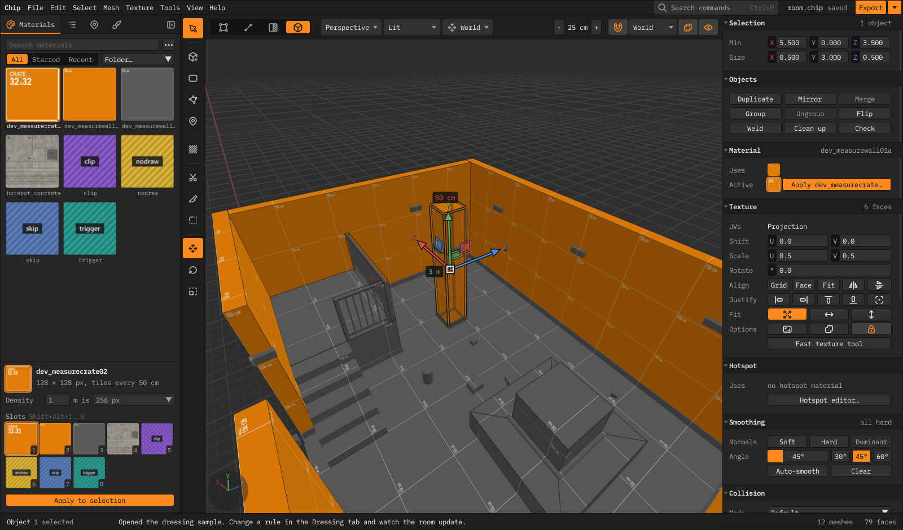
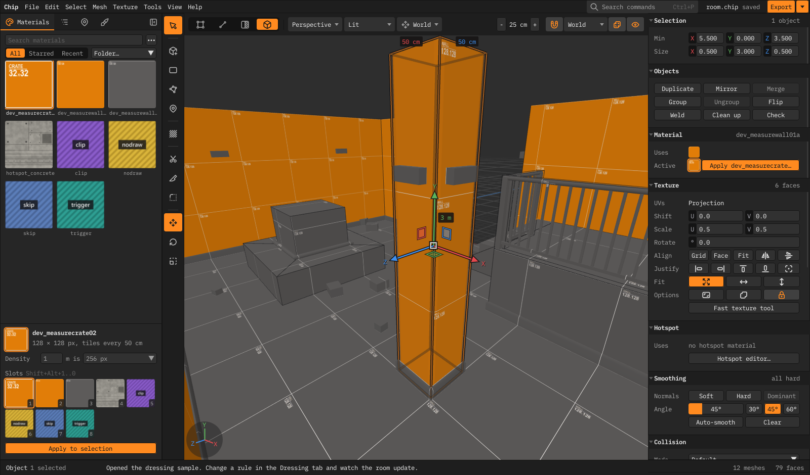
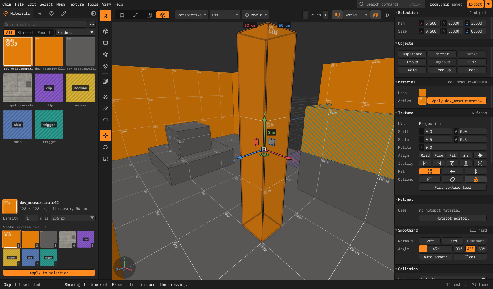

<h1 align="center">Chip</h1>

A level editor for game developers

  <a href="https://github.com/frinky04/chip/releases/latest">Download</a> ·
  <a href="docs/guide.md">Guide</a> ·
  <a href="CONTRIBUTING.md">Contributing</a>

Chip is a standalone level editor for Windows, in the spirit of Scythe and Source 2 Hammer. Build rooms from
polygon meshes, texture them on a metre grid, place your game's entities, and export a `.glb` that Godot (or any glTF
engine) imports as a playable level with collision.

## Features

- **Fast polygon modelling.** Blocks, stairs, arches and prisms; extrude, inset, bevel, bridge, knife and clip; typed
  values while you drag (`1.5`, `150cm`, `90°`).
- **Texturing on a metre grid.** Per-level texel density, align/fit/justify, hotspots for trim sheets, and tool
  surfaces (nodraw, clip, trigger, skip).
- **Dressing.** Rules turn the blockout into finished geometry (baseboards, trims, railings, stairs, lights) and
  follow your edits. Press `` ` `` to flip between the two.
- **Your game's entities.** Godot scenes under `res://entities/` (or any engine's manifest) appear as placeable classes
  with editable properties.
- **Reuse.** Linked copies share live edits, and prefabs are shared across every level in the project.
- **Export to any engine.** glTF with colliders, triggers and entities marked; a Godot addon that re-imports on save;
  OBJ; and a headless CLI for build scripts and coding agents.

| Dressed | Blockout |
|---|---|
|  |  |

## Get started

Download `chip-vX.Y.Z-win-x64.zip` from [Releases](https://github.com/frinky04/chip/releases), unzip it and run
`Chip.exe`. Chip needs OpenGL 3.3.

1. `Shift+B`, drag out a floor, move the mouse for height, click.
2. `3` for face mode, then `Shift+drag` a face to extrude it.
3. `Shift+T` applies the selected material.
4. `Ctrl+S` saves the `.chip` level, `Ctrl+E` exports the `.glb`.

`F1` lists every shortcut and `Ctrl+P` finds any command.

**Using Chip in a game repo:** copy [scripts/fetch-chip.py](scripts/fetch-chip.py) into it and run
`python tools/fetch-chip.py --pin latest`. Commit the `.chip-version` file it writes, and everyone else runs
`python tools/fetch-chip.py` to get the same build in `.chip/`.

## Documentation

- [Guide](docs/guide.md): the whole editor, section by section
- [Dressing](docs/dressing.md) · [Entities](docs/entities.md) · [Other engines](docs/engines.md) ·
  [Godot addon](godot/addons/chip_import/README.md)
- [Agent skill](skills/chip/SKILL.md): lets coding agents connect a game, edit and export levels
- [Contributing](CONTRIBUTING.md): building from source (.NET 10), tests and releases
